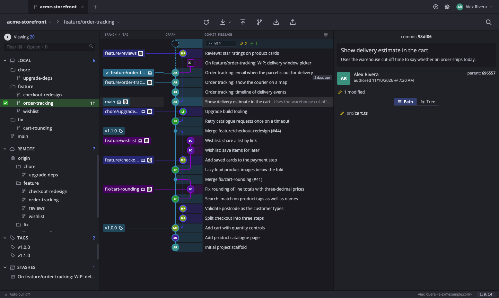

# Branchline

A graph-first Git client for macOS with profile switching, inspired by GitKraken. It drives the `git` CLI already on the machine.



*The screenshot shows a made-up demo repository.*

## Features

- Commit graph with branches, tags and stashes; hide any branch from the graph
- Stage files or single hunks, commit, amend, pull, push, fetch
- Merge, rebase, squash, cherry-pick, reset; select several commits to see their combined changes
- Profiles that switch your Git name and email, each with its own open repositories and avatar
- Auto-pull chosen branches on a timer, per repository
- Pull request chip for the current branch and clone from GitHub (both use the `gh` CLI)
- Themes (Dark, Midnight, Ocean, Light), text size, collapsible side panel, self-updating

## Optional features

Both are off by default; turn them on in Preferences.

- **Pull requests** — open pull requests listed in the left panel, with check status and review state shown there and next to each branch. Double-click one to check it out. Uses the `gh` CLI.
- **Ticket keys** — keys such as `ABC-1234` in branch names and commit messages link to your Jira, and the key from the current branch is offered as a commit summary prefix.

## Install on another Mac

Paste this into Terminal:

```
curl -fsSL https://raw.githubusercontent.com/jeanraymonddaher/branchline/main/scripts/install.sh | bash
```

This downloads the latest release, puts Branchline in Applications and opens it. The app is not notarized; the script clears the macOS quarantine flag so it opens normally.

Needs `git` (Xcode command line tools). Cloning from the GitHub list also needs the GitHub CLI signed in (`brew install gh && gh auth login`).

## Updates

Branchline checks GitHub for a newer release when it starts and offers "Update and Restart". You can also use Branchline → Check for Updates….

To publish a new version from the development Mac:

```
npm run release            # 1.0.0 -> 1.0.1, builds, pushes, publishes
npm run release -- minor   # or major, or an exact version
```

## Develop

```
npm install
npm start          # run from source
npm run dist       # build dist/Branchline-<version>-universal.dmg
npm run icon       # regenerate build/icon.png
npm run release    # publish a new version (see Updates)
```

- `src/main.js` — Electron main process: runs git/gh, file watching, menus.
- `src/renderer/graph.js` — lane layout and per-row drawing of the commit graph.
- `src/renderer/git.js` — git commands and parsing.
- `src/renderer/app.js` — the UI.

Settings, tabs and profiles are stored in `~/Library/Application Support/Branchline/state.json`.
